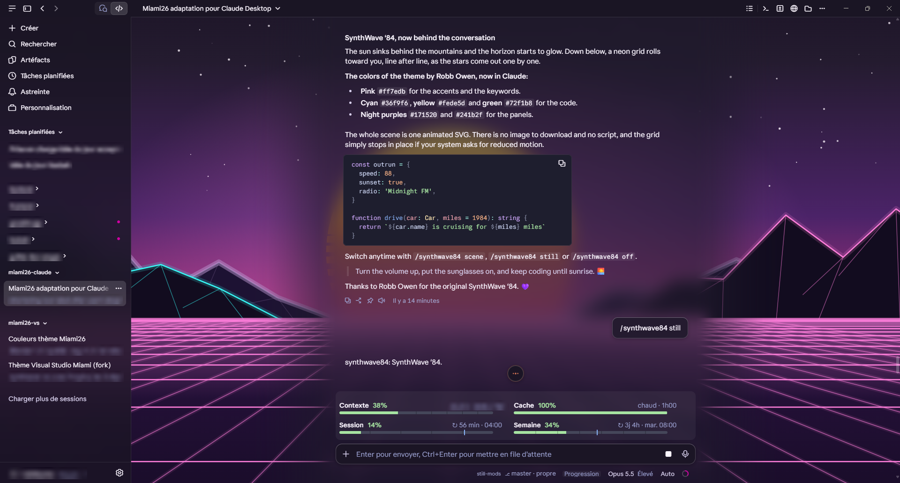

# SynthWave '84 - Claude Desktop theme

A port of the awesome [SynthWave '84 - VS Code theme](https://github.com/robb0wen/synthwave-vscode) by [Robb Owen](https://github.com/robb0wen) to the Claude desktop app, as a mod.

The neon colors of the theme paint the whole app, over an animated retro sunset behind the conversation: a striped sun sinking behind wireframe mountains, a glowing horizon, a neon grid rolling toward you, twinkling stars and the odd shooting star. The scene stops moving when the system asks for reduced motion.

Also available for [Visual Studio](https://github.com/stillgbx/synthwave-vs).



## Install

In Claude Code, add this repository as a marketplace, then install the plugin from it:

```
/plugin marketplace add stillgbx/synthwave-claude
/plugin install synthwave84@synthwave84
```

In the Claude desktop app, you can also open *Settings > Plugins*, add the marketplace `stillgbx/synthwave-claude` with **Add**, then install **synthwave84**.

The look shows in the desktop and mobile apps. The terminal and the editors don't draw themes. SynthWave '84 is a dark theme: in light mode, the app keeps its own colors.

## Use

```
/synthwave84 scene     the grid rolling toward you behind the conversation (default)
/synthwave84 still     the same view, standing still
/synthwave84 off       back to the app's own look, for this session
```

The choice is kept for the next sessions.

## Neon glow

The glow around the text of the VS Code "Neon Dreams" mode isn't possible here: a mod sets the app's colors, not the style of its text. The neon lives in the scene instead.

## Files

* `hooks/register.tsx`: the colors, the backdrop and the `/synthwave84` command.
* `hooks/scene.ts`: the sunset and the grid, drawn as one SVG.
* `hooks/make-colors.js`: the design system's helper that turns a few colors into a whole theme. Don't edit it.

## Credits

Theme colors and icon come from [SynthWave '84](https://github.com/robb0wen/synthwave-vscode) by Robb Owen (MIT License).
